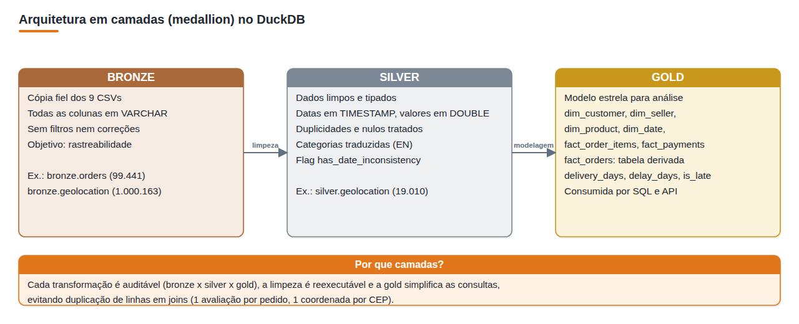
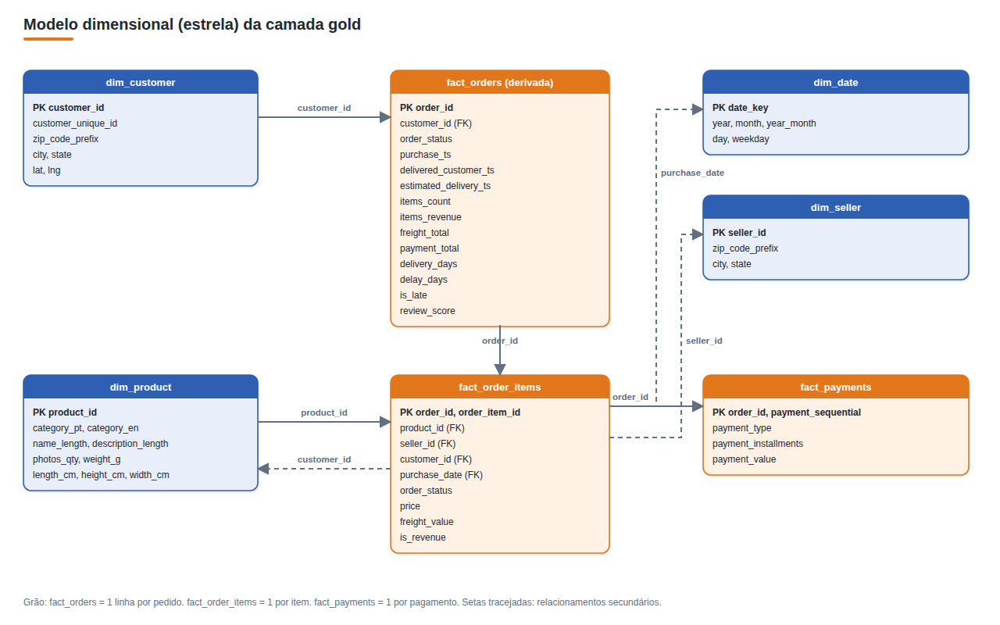
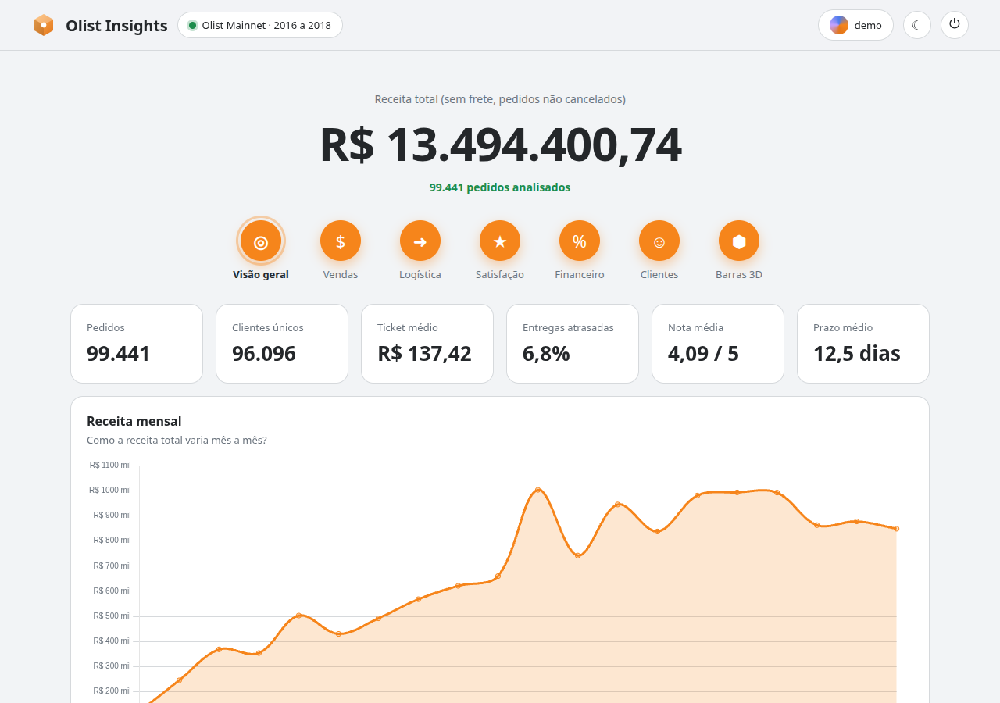
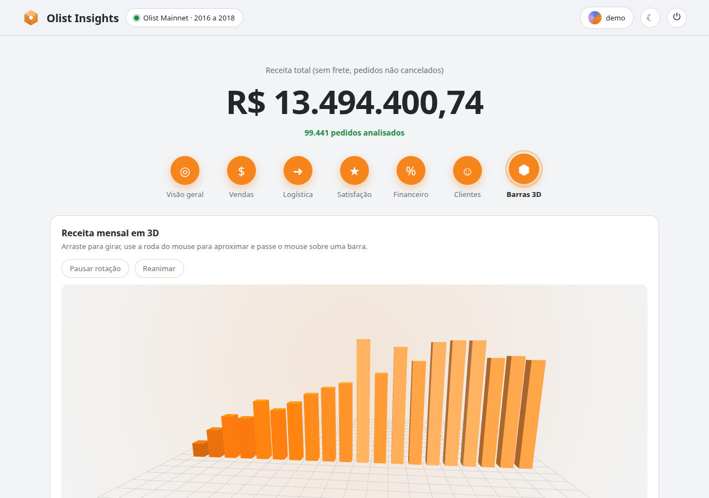

<p align="center">
  
</p>

<p align="center">
  <br>
  <b>Do CSV bruto à decisão, em camadas auditáveis.</b><br>
  Pipeline ETL idempotente, mini Data Warehouse em <b>DuckDB</b> com modelo estrela<br>
  e um dashboard protegido por login sobre o dataset público de e-commerce da <b>Olist</b>.
</p>

<p align="center">
  
  
  
  
  
  
</p>

---

## O problema

A Olist conecta pequenos lojistas a grandes marketplaces. O desafio pede transformar nove tabelas CSV brutas
(pedidos, itens, pagamentos, avaliações, clientes, vendedores, produtos, geolocalização e tradução de categorias)
em uma base confiável e responder perguntas de negócio:

1. Quais as 10 categorias que mais geram receita?
2. Qual o percentual de pedidos entregues com atraso, por estado?
3. Como a nota média de avaliação muda quando o pedido atrasa?
4. Qual o frete médio por estado?
5. Quantos clientes compram mais de uma vez?

## A solução em uma imagem


| Etapa | O que acontece | Onde |
|---|---|---|
| **Extract** | Lê os 9 CSVs sem alterá-los | `src/extract.py` |
| **Transform** | Limpa, tipa, padroniza e registra cada regra de qualidade | `src/transform.py` |
| **Load** | Reconstrói o warehouse do zero (Bronze, Silver, Gold) | `src/load.py`, `sql/` |
| **Analyze** | 5 consultas SQL, gráficos e notebook com conclusões | `sql/analytics.sql`, `notebooks/` |
| **Serve** | Dashboard com login, API protegida e cenas 3D | `public/`, `api/` |

## Principais resultados

| Indicador | Valor |
|---|---:|
| Pedidos | 99.441 |
| Receita (sem frete) | R$ 13,49 mi |
| Clientes únicos | 96.096 |
| Ticket médio | R$ 137,42 |
| Pedidos entregues com atraso | 6,78 % |
| Nota média | 4,09 |
| Nota média com atraso x no prazo | 2,27 x 4,29 |
| Clientes que compraram mais de uma vez | 3,04 % |

O atraso derruba a nota em quase **2 pontos**, e a recompra é baixa: duas alavancas claras para o negócio.

## Como executar

```bash
python3 -m venv .venv && source .venv/bin/activate
pip install -r requirements.txt

# 1. Baixe o dataset no Kaggle e extraia os 9 CSVs em data/raw/ (os originais nunca são alterados)
# 2. Rode o pipeline (Extract, Transform, Load)
python src/pipeline.py
# 3. Gere e execute o notebook (consultas SQL, gráficos e conclusões)
python src/build_notebook.py
```

O pipeline é idempotente: o warehouse é reconstruído do zero a cada execução.

## Modelagem (opção B, com modelo dimensional na Gold)



- **bronze**: cópia fiel dos CSVs (tudo `VARCHAR`), para rastreabilidade.
- **silver**: dados limpos e tipados (datas, valores numéricos, duplicidades, categorias traduzidas).
- **gold**: modelo estrela pronto para análise: `dim_customer`, `dim_seller`, `dim_product`, `dim_date`,
  `fact_order_items`, `fact_payments` e `fact_orders` (tabela derivada com `delivery_days`, `delay_days`, `is_late`,
  `items_revenue`, `review_score`).

**Justificativa:** as camadas separam preservação, limpeza e consumo, e tornam cada transformação auditável.
A gold em estrela simplifica as consultas e evita duplicação de linhas em joins
(1 avaliação por pedido, 1 coordenada por CEP).



## Decisões principais

- Receita = soma de `price` (sem frete) de pedidos não cancelados nem indisponíveis. Receita não é lucro.
- Prazo e atraso só são calculados para pedidos `delivered` com data de entrega e cronologia válida; nenhuma data é inventada.
- Cliente = `customer_unique_id` (o `customer_id` muda a cada pedido).
- Valores ausentes ficam nulos; a única exceção é a categoria de produto ausente, rotulada `desconhecida`.
- Detalhes, contagens e justificativas de cada uma das 21 regras: [docs/data_quality.md](docs/data_quality.md).

## Premissas e limitações

- O dataset não tem custo de produto: a receita analisada é faturamento, não lucro.
- É uma amostra de um marketplace (2016 a 2018), não toda a operação de um varejista.
- Valores ausentes não são imputados; pedidos sem data de entrega não recebem prazo.
- Só 3 % dos clientes recompram, então métricas de recorrência têm base pequena.

## Dashboard

<p align="center">
  
  
</p>

- 7 abas, tema claro e escuro, filtro por estado, busca e gráficos clicáveis (Chart.js).
- Login com poliedro 3D animado e aba "Barras 3D" com a receita mensal (Three.js).
- Senha verificada com `scrypt`; sessão em cookie `HttpOnly` assinado com HMAC.
- Os dados ficam em arquivo privado e só saem por `/api/data` com sessão válida.
- Variáveis de ambiente: `AUTH_USER`, `AUTH_PASS_HASH` (gere com `node scripts/make-credentials.js "<senha>"`) e `SESSION_SECRET`.
- Teste local: `node scripts/dev-server.js`.


## Estrutura

| Caminho | Conteúdo |
|---|---|
| `data/raw/` | CSVs originais (RAW), intocados e ignorados pelo Git |
| `data/processed/` | Tabelas tratadas em Parquet (saída do Transform) |
| `data/warehouse/olist.duckdb` | Data Warehouse |
| `src/` | Pipeline ETL, geração do notebook, diagramas, relatório e exportação para a web |
| `sql/` | `schema.sql` e `gold.sql` (DDL e carga) e `analytics.sql` (5 análises) |
| `reports/charts/` | Gráficos (PNG) |
| `public/` e `api/` | Frontend e API do dashboard |
| `docs/` | Regras de qualidade, diagramas, relatório técnico e apresentação |
| `assets/` | Logo e banner |

## Documentos

- [Relatório técnico (PDF, 20 páginas)](docs/relatorio/relatorio-tecnico-olist.pdf)
- Apresentação do desafio: [PDF](docs/apresentacao/apresentacao-olist.pdf) e [PPTX](docs/apresentacao/apresentacao-olist.pptx)
- [Regras de qualidade de dados](docs/data_quality.md)
- Diagramas em `docs/diagrams/` (SVG e PNG)

## Uso de Inteligência Artificial

A IA (Claude Code, da Anthropic) foi utilizada para fins de **documentação** e como **auxílio na criação do
frontend e da interface de apresentação do dashboard**. O código do pipeline, as regras de negócio e os resultados
são de responsabilidade da autora e foram revisados por ela. O processo foi iterativo: a autora definiu as
regras e as perguntas, a IA gerou rascunhos de documentação e da interface, e cada entrega foi conferida contra os dados.

---

<p align="center">
  <br>
  Desafio técnico desenvolvido por <b>Juliana Ballin Lima</b> para a vaga de Data Engineer I na Bemol Digital.
</p>
