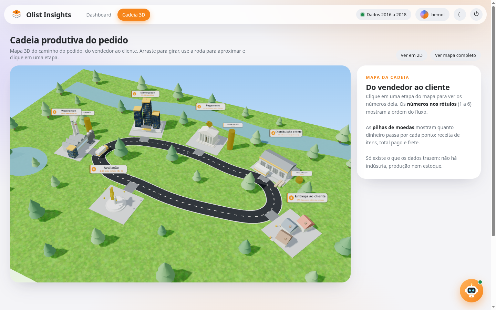
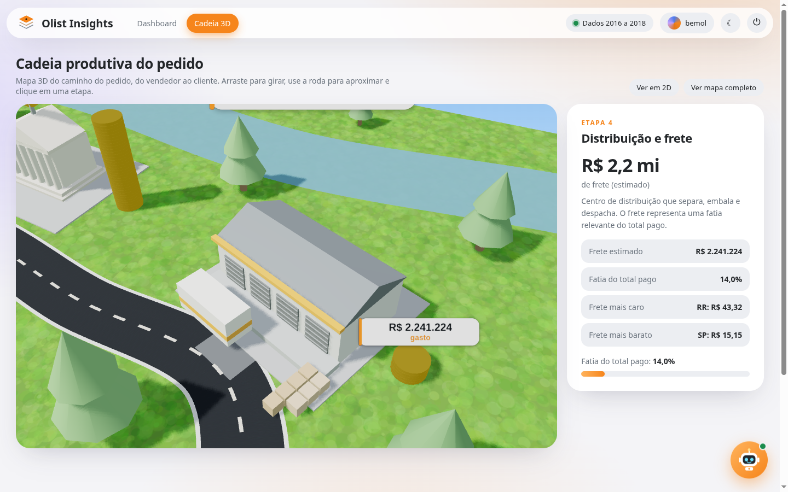
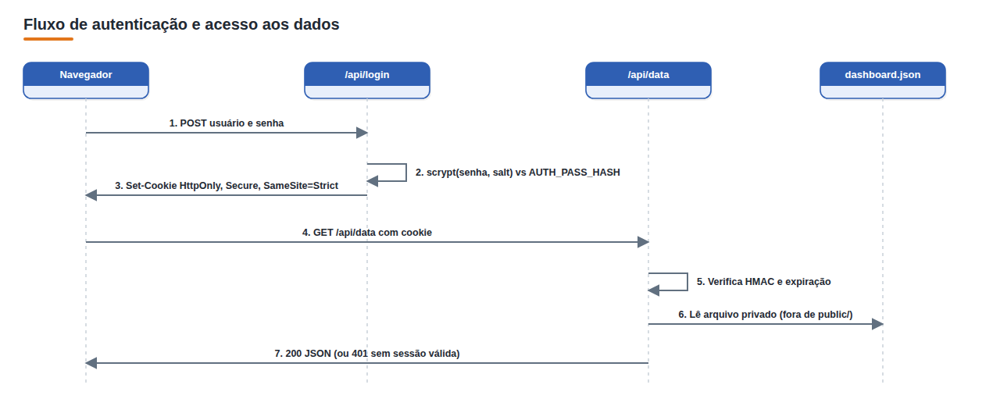

<p align="center">
  
</p>

<p align="center">
  <br>
  <b>Do CSV bruto à decisão, em camadas auditáveis.</b><br>
  Pipeline ETL idempotente, mini Data Warehouse em <b>DuckDB</b> com modelo estrela<br>
  e um dashboard protegido por login sobre o dataset público de e-commerce da <b>Olist</b>.
</p>

<p align="center">
  
  
  
  
  
  
</p>

---

## Acesso rápido

| O quê | Onde |
|---|---|
| **Dashboard online (deploy)** | https://data-engineer-challenge.vercel.app |
| **Login de teste** | usuário `bemol` e senha `bemol@2026` (ambiente de teste) |
| **Relatório técnico (PDF)** | [docs/relatorio/relatorio-tecnico-olist.pdf](docs/relatorio/relatorio-tecnico-olist.pdf) |
| **Apresentação** | [PDF](docs/apresentacao/apresentacao-olist.pdf) e [PPTX](docs/apresentacao/apresentacao-olist.pptx) |
| **Notebook com as 10 análises** | [notebooks/exploratory_analysis.ipynb](notebooks/exploratory_analysis.ipynb) |
| **Rodar no Colab** | [Abrir no Colab](https://colab.research.google.com/github/JulianaBallin/data-engineer-challenge/blob/main/notebooks/executar_no_colab.ipynb) (repositório público) ou veja o [guia](#opção-2-jupyter-ou-google-colab) |

## Visão geral

O projeto transforma nove tabelas CSV brutas da Olist (pedidos, itens, pagamentos, avaliações, clientes, vendedores, produtos,
geolocalização e tradução de categorias) em uma base confiável e responde a **dez perguntas de negócio**, duas por tópico:


| Etapa | O que acontece | Onde |
|---|---|---|
| **Extract** | Lê os 9 CSVs sem alterá-los | `src/extract.py` |
| **Transform** | Limpa, tipa, padroniza e registra cada regra de qualidade | `src/transform.py` |
| **Load** | Reconstrói o warehouse do zero (Bronze, Silver, Gold) | `src/load.py`, `sql/` |
| **Analyze** | 10 consultas SQL, gráficos e notebook com conclusões | `sql/analytics.sql`, `notebooks/` |
| **Serve** | Dashboard com login, API protegida, cadeia 3D e assistente Olli | `public/`, `api/` |

## Como executar do zero

### Opção 1: um comando (`make run`)

Requisitos: Python 3.10+ e `make`. Coloque os 9 CSVs do [dataset no Kaggle](https://www.kaggle.com/datasets/olistbr/brazilian-ecommerce/data)
em `data/raw/` (ou configure `~/.kaggle/kaggle.json`, e o `make` baixa sozinho).

```bash
git clone https://github.com/JulianaBallin/data-engineer-challenge.git
cd data-engineer-challenge
make run
```

O `make run` cria o ambiente virtual, instala o `requirements.txt`, confere os dados, roda o ETL (Bronze, Silver e Gold),
executa o notebook das 10 análises e exporta os agregados do dashboard. Outros comandos: `make help`.

| Comando | Faz |
|---|---|
| `make run` | tudo de uma vez |
| `make pipeline` | só o ETL |
| `make notebook` | ETL e notebook de análises |
| `make docs` | regenera diagramas, relatório e apresentação |
| `make dev` | dashboard local em http://localhost:3000 |
| `make test` | testes de API (com o servidor local no ar) |

### Opção 2: Jupyter ou Google Colab

- **Jupyter local:** `pip install -r requirements.txt`, `python src/pipeline.py` e abra `notebooks/exploratory_analysis.ipynb`.
- **Google Colab:** abra [`notebooks/executar_no_colab.ipynb`](notebooks/executar_no_colab.ipynb) (pelo Colab: *File, Open notebook, GitHub*,
  com o repositório público). Ele clona o repositório, instala as dependências, recebe os CSVs (upload ou Kaggle) e roda o ETL e as análises.

### Opção 3: passo a passo manual

```bash
python3 -m venv .venv && source .venv/bin/activate
pip install -r requirements.txt
python src/pipeline.py          # Extract, Transform e Load
python src/build_notebook.py    # análises, gráficos e conclusões
python src/export_web.py        # JSON do dashboard
```

O pipeline é idempotente: o warehouse é reconstruído do zero a cada execução, e os CSVs originais nunca são alterados.

## As dez perguntas e o que os dados mostram

| Tópico | Pergunta | Achado |
|---|---|---|
| Vendas | 1a. 10 categorias com maior receita | `health_beauty` lidera (R$ 1,26 mi); as 3 maiores somam 25,9% |
| Vendas | 1b. Receita mês a mês | Cresce de R$ 120 mil (jan/2017) a cerca de R$ 900 mil, com pico na Black Friday (nov/2017) e estabilização em 2018 |
| Logística | 2a. Tempo médio de entrega por estado | Média de 12,5 dias: de 8,7 (SP) a 29,3 (RR) |
| Logística | 2b. % de pedidos entregues com atraso | 6,8% no total; Alagoas chega a 21,4% |
| Satisfação | 3a. Distribuição das notas | 57,8% dão nota 5; 14,7% dão 1 ou 2 |
| Satisfação | 3b. Atraso reduz a nota? | Sim: 2,27 com atraso contra 4,29 no prazo |
| Financeiro | 4a. Receita por categoria e participação | As 10 maiores somam 62,4%; nenhuma passa de 9,3% |
| Financeiro | 4b. Frete médio por estado | De R$ 15,15 (SP) a R$ 43,32 (RR) por item |
| Clientes | 5a. % de clientes que compraram mais de uma vez | Só 3,0%: baixa retenção |
| Pagamentos | 5b. Meios de pagamento mais usados | Cartão de crédito (73,9%) e boleto (19,0%) |

Cada pergunta tem **consulta SQL** ([sql/analytics.sql](sql/analytics.sql)), **gráfico** ([reports/charts/](reports/charts/)) e uma
**conclusão de negócio** de 2 a 4 linhas, geradas no notebook a partir dos próprios resultados.

## Decisões de modelagem

Arquitetura em camadas (**medalhão**) no DuckDB, com **modelo dimensional em estrela** na camada gold:


- **bronze:** cópia fiel dos CSVs (tudo `VARCHAR`), para rastreabilidade.
- **silver:** dados limpos e tipados (datas, valores numéricos, duplicidades, categorias traduzidas).
- **gold:** modelo estrela pronto para análise: `dim_customer`, `dim_seller`, `dim_product`, `dim_date`, `fact_order_items`,
  `fact_payments` e `fact_orders` (**tabela derivada** com `delivery_days`, `delay_days`, `is_late`, `items_revenue`, `review_score`).

**Justificativa (em poucas linhas):** as camadas separam preservação, limpeza e consumo, e tornam cada transformação auditável e
reexecutável. A gold em estrela simplifica as consultas (poucos joins, nomes de negócio) e evita erros de duplicação de linhas
(1 avaliação por pedido, 1 coordenada por CEP).


## Regras de qualidade

Foram aplicadas **21 regras**, todas documentadas com contagem de registros e justificativa em
[docs/data_quality.md](docs/data_quality.md) (gerado a cada execução). As principais:

| Problema | Tratamento | Registros |
|---|---|--:|
| Cronologia inválida (entrega antes da aprovação etc.) | Sinaliza (`has_date_inconsistency`) e exclui das métricas de prazo; não corrige datas | 189 |
| Geolocalização com milhares de coordenadas por CEP | Agrega em 1 linha por prefixo de CEP (média de lat/lng) | 981.111 |
| `review_id` repetido em pedidos distintos | Na gold usa 1 avaliação por pedido (a mais recente) | 814 |
| Pagamento inválido (`not_defined`) e parcelas menores que 1 | Remove a linha inválida; ajusta parcelas para 1 | 3 e 2 |
| Categoria de produto ausente | Rotula como `desconhecida`, sem inferir | 610 |
| Categorias sem tradução | Tradução manual (2 categorias) | 13 |
| Integridade referencial (6 relações) | Verificada, sem perdas | 0 |

## Premissas e limitações

- **Receita = soma de `price`** (sem frete) de pedidos não cancelados nem indisponíveis. O dataset **não tem custo do produto**:
  receita não é lucro, e não é possível falar em margem.
- Prazo e atraso só são calculados para pedidos `delivered` com data de entrega e cronologia válida. **Nenhuma data é inventada.**
- Cliente = `customer_unique_id` (o `customer_id` muda a cada pedido).
- Valores ausentes ficam nulos; a única exceção é a categoria ausente (`desconhecida`).
- É uma amostra de um marketplace (2016 a 2018), não toda a operação de um varejista. Os meses de 2016 e set/out de 2018 têm pouco volume e ficam fora da série mensal.
- O frete é o valor cobrado por item, não o custo logístico real.
- A projeção de receita usa só 20 meses de histórico: é cenário, não previsão (margem de erro grande).

## Dashboard

<p align="center">
  
  
</p>

<p align="center">
  
  
</p>

- **Online:** https://data-engineer-challenge.vercel.app (login de teste: `bemol` / `bemol@2026`).
- Menu com **Dashboard** (visão geral, vendas, logística, satisfação, financeiro, clientes e projeção) e **Cadeia 3D**.
  Tema claro e escuro, filtro por estado, busca e gráficos clicáveis (Chart.js).
- **Projeção:** regressão linear nos próximos 12 meses (intervalo de 95%, ajuste fraco) e cenários anuais (-5%, 0%, +15%)
  sobre o ritmo dos últimos 6 meses. São estimativas com margem de erro grande; só se projetam receita, pedidos, frete e total pago.
- **Cadeia 3D (supply chain):** mapa realista com estrada, rio e seis estações (vendedores, marketplace, pagamento, distribuição,
  cliente e avaliação), com caminhão e pacotes em movimento. Pilhas de moedas mostram o gasto (itens, total pago e frete).
  Ao clicar em uma etapa, o painel lateral mostra só os números daquela etapa.
- **Olli, assistente de dados (RAG):** chat que responde **só** com os dados do histórico (`api/chat.js`, base em `api/_kb.js`).
  Se não houver o dado, ela avisa. Com a variável `ANTHROPIC_API_KEY` o Claude redige a resposta usando apenas os trechos
  recuperados; sem ela, a Olli devolve os próprios trechos.
- **Segurança:** senha verificada com `scrypt`; sessão em cookie `HttpOnly` assinado com HMAC; os dados só saem por `/api/data` com sessão válida.
- Variáveis de ambiente: `AUTH_USER`, `AUTH_PASS_HASH` (gere com `node scripts/make-credentials.js "<senha>"`) e `SESSION_SECRET`
  (opcional: `ANTHROPIC_API_KEY`). Teste local: `make dev`.



## Testes

- `scripts/test-api.js` (36 verificações): autenticação, proteção dos dados, projeção e perguntas à Olli (inclusive fora do escopo).
- Dashboard validado em Chrome headless (todas as seções, temas claro e escuro, desktop e celular), sem erros de JavaScript.

## Estrutura

| Caminho | Conteúdo |
|---|---|
| `src/` | Pipeline ETL, geração do notebook, diagramas, relatório, apresentação e exportação para a web |
| `sql/` | `schema.sql` e `gold.sql` (DDL e carga) e `analytics.sql` (10 análises) |
| `notebooks/` | Notebook das análises e notebook para o Colab |
| `docs/` | Regras de qualidade, diagramas, relatório técnico e apresentação |
| `reports/charts/` | Gráficos das 10 perguntas (PNG) |
| `data/raw/` | CSVs originais (RAW), intocados e ignorados pelo Git |
| `data/processed/` | Tabelas tratadas em Parquet (saída do Transform) |
| `data/warehouse/olist.duckdb` | Data Warehouse |
| `public/` e `api/` | Frontend e API do dashboard (Vercel) |
| `Makefile` e `requirements.txt` | Execução em um comando e dependências |

## Uso de Inteligência Artificial

Foi utilizado o **Claude Code (Anthropic)** em duas frentes: **documentação** (README, relatório, apresentação e comentários) e
**apoio na criação do frontend e da interface de apresentação do dashboard** (layout, gráficos, cena 3D e assistente Olli).
O processo foi iterativo: a autora definiu o problema, as regras de negócio e as perguntas, a IA produziu rascunhos de código,
texto e interface, e cada entrega foi conferida contra os dados (as conclusões do notebook são calculadas, e a suíte de testes
valida a API). Código do pipeline, regras de negócio e resultados são de responsabilidade da autora.

---

<p align="center">
  <picture>
    <source media="(prefers-color-scheme: dark)" srcset="assets/logo/bemol-digital-logo-branca.png">
    
  </picture><br>
  Desafio técnico desenvolvido por <b>Juliana Ballin Lima</b> para a vaga de Data Engineer I na Bemol Digital.
</p>
