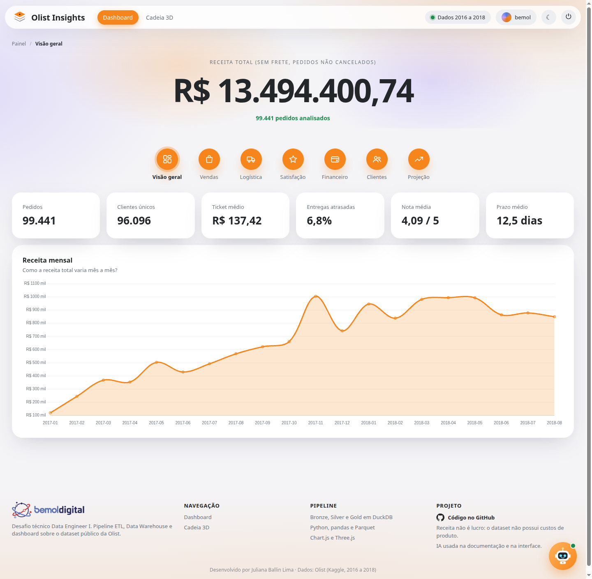
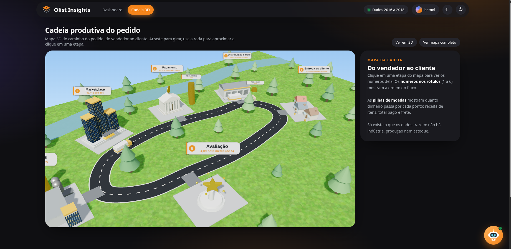
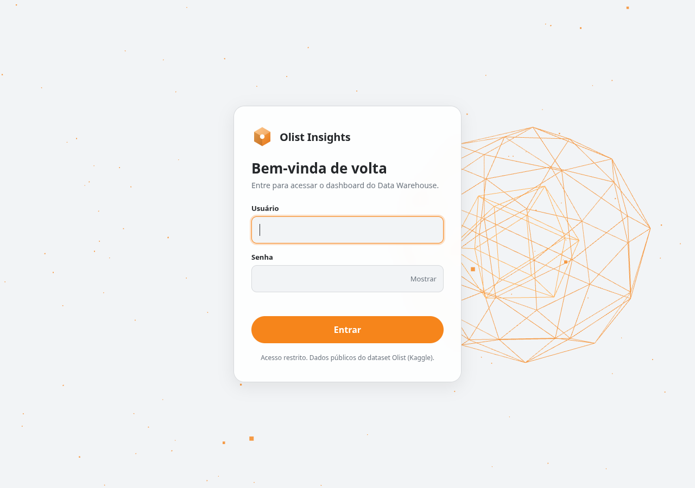
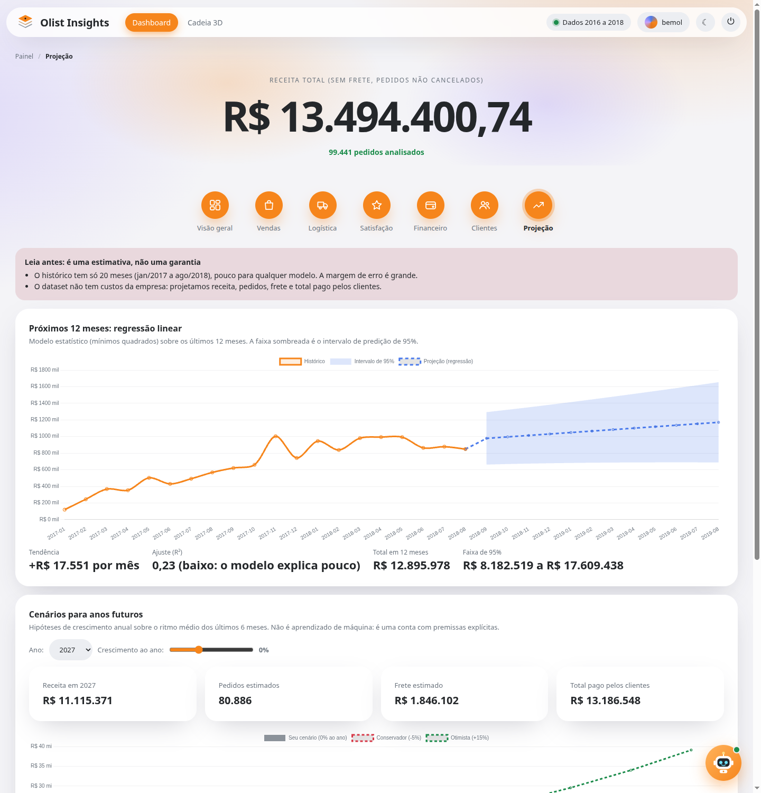
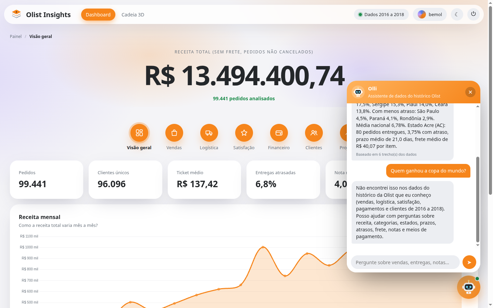
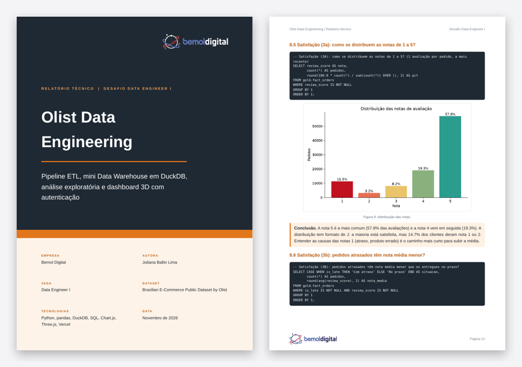
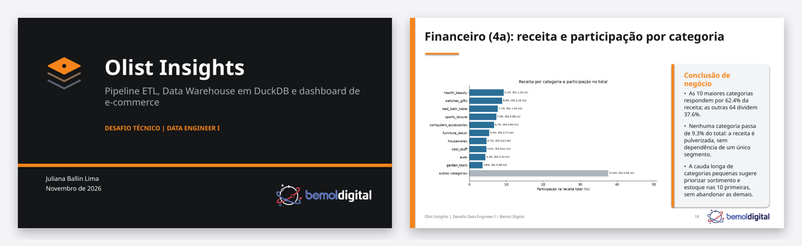
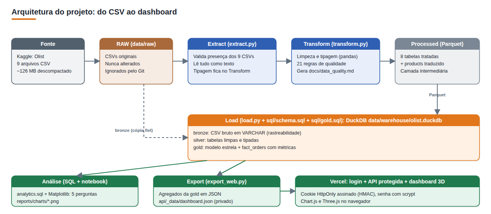

<p align="center">
  
</p>

<p align="center">
  <b>Do CSV bruto à decisão, em camadas auditáveis.</b><br>
  Pipeline ETL, Data Warehouse em DuckDB e dashboard com login sobre o dataset público da Olist.
</p>

<p align="center">
  <a href="https://data-engineer-challenge.vercel.app"></a>
</p>

<p align="center">
  
  
  
  
  
</p>

## Acesso rápido

| | |
|---|---|
| **Dashboard online** | https://data-engineer-challenge.vercel.app |
| **Login de teste** | usuário `bemol` e senha `bemol@2026` |
| **Executar tudo** | `make run` (veja [como executar](#como-executar)) |
| **Relatório técnico** | [PDF](docs/relatorio/relatorio-tecnico-olist.pdf) |
| **Apresentação** | [PDF](docs/apresentacao/apresentacao-olist.pdf) e [PPTX](docs/apresentacao/apresentacao-olist.pptx) |
| **Notebook (10 análises)** | [notebooks/exploratory_analysis.ipynb](notebooks/exploratory_analysis.ipynb) |
| **Colab** | [Abrir no Colab](https://colab.research.google.com/github/JulianaBallin/data-engineer-challenge/blob/main/notebooks/executar_no_colab.ipynb) |

## Telas

<table>
  <tr>
    <td width="50%"><br><sub><b>Dashboard</b>: 7 seções, tema claro e escuro</sub></td>
    <td width="50%"><br><sub><b>Cadeia 3D</b>: mapa com o fluxo do pedido (1 a 6)</sub></td>
  </tr>
  <tr>
    <td width="50%"><br><sub><b>Login seguro</b>: senha com scrypt e sessão em cookie HttpOnly assinado</sub></td>
    <td width="50%"><br><sub><b>Projeção</b>: regressão e cenários, com a margem de erro</sub></td>
  </tr>
</table>

### Olli, a assistente virtual

<table>
  <tr>
    <td width="120" align="center"></td>
    <td>Chat que responde <b>só com os dados do histórico</b> (RAG) e avisa quando não tem o dado. Entende perguntas de acompanhamento e sugere os próximos passos.</td>
  </tr>
</table>

<p align="center">
  
</p>

### Relatório e apresentação

<p align="center">
  
  
</p>

## Como executar

Requisitos: Python 3.10+ e `make`. Coloque os 9 CSVs do [dataset no Kaggle](https://www.kaggle.com/datasets/olistbr/brazilian-ecommerce/data) em `data/raw/` (ou configure `~/.kaggle/kaggle.json` e o `make` baixa sozinho).

```bash
git clone https://github.com/JulianaBallin/data-engineer-challenge.git
cd data-engineer-challenge
make run
```

O `make run` cria o ambiente virtual, instala o `requirements.txt`, roda o ETL (Bronze, Silver e Gold), executa o notebook das 10 análises e exporta os dados do dashboard. Veja os demais comandos com `make help`.

**Jupyter ou Colab:** `pip install -r requirements.txt`, `python src/pipeline.py` e abra o notebook, ou use o [notebook do Colab](notebooks/executar_no_colab.ipynb) (clona, instala, recebe os CSVs e roda tudo).

<details>
<summary>Rodar o dashboard localmente</summary>

```bash
export AUTH_USER=bemol SESSION_SECRET=troque-este-segredo
export AUTH_PASS_HASH=$(node scripts/make-credentials.js "sua-senha" | head -1 | cut -d= -f2-)
make dev            # http://localhost:3000
make test           # testes de API (36 verificações)
```
Variáveis no Vercel: `AUTH_USER`, `AUTH_PASS_HASH`, `SESSION_SECRET` (opcional: `ANTHROPIC_API_KEY` para a Olli redigir com o Claude).
</details>

## Visão geral e modelagem



Arquitetura em camadas (**medalhão**) no DuckDB, com **modelo estrela** na gold:

- **bronze:** cópia fiel dos CSVs (tudo `VARCHAR`), para rastreabilidade.
- **silver:** dados limpos e tipados, com 21 regras de qualidade.
- **gold:** `dim_customer`, `dim_seller`, `dim_product`, `dim_date`, `fact_order_items`, `fact_payments` e a derivada `fact_orders` (`delivery_days`, `delay_days`, `is_late`).

**Justificativa:** as camadas separam preservação, limpeza e consumo e tornam cada transformação auditável e reexecutável. A estrela simplifica as consultas e evita duplicação de linhas em joins (1 avaliação por pedido, 1 coordenada por CEP).


## Regras de qualidade

21 regras, todas com contagem e justificativa em [docs/data_quality.md](docs/data_quality.md). As principais:

| Problema | Tratamento | Registros |
|---|---|--:|
| Datas fora de ordem (entrega antes da aprovação) | Sinaliza e exclui das métricas de prazo; não corrige | 189 |
| Várias coordenadas por CEP | 1 linha por prefixo de CEP | 981.111 |
| `review_id` repetido | 1 avaliação por pedido (a mais recente) | 814 |
| Categoria de produto ausente | Rotula `desconhecida`, sem inferir | 610 |
| Pagamento inválido e parcelas menores que 1 | Remove e ajusta | 3 e 2 |
| Integridade referencial (6 relações) | Verificada, sem perdas | 0 |

## As dez perguntas

Cada uma tem consulta SQL ([sql/analytics.sql](sql/analytics.sql)), gráfico ([reports/charts/](reports/charts/)) e conclusão de negócio no notebook.

| Tópico | Pergunta | Achado |
|---|---|---|
| Vendas | 1a. 10 categorias com maior receita | `health_beauty` lidera (R$ 1,26 mi); as 3 maiores somam 25,9% |
| Vendas | 1b. Receita mês a mês | De R$ 120 mil a cerca de R$ 900 mil; pico na Black Friday de 2017 |
| Logística | 2a. Tempo médio de entrega por estado | 12,5 dias: de 8,7 (SP) a 29,3 (RR) |
| Logística | 2b. % de pedidos com atraso | 6,8% no total; AL chega a 21,4% |
| Satisfação | 3a. Distribuição das notas | 57,8% dão nota 5; 14,7% dão 1 ou 2 |
| Satisfação | 3b. Atraso reduz a nota? | Sim: 2,27 com atraso contra 4,29 no prazo |
| Financeiro | 4a. Receita por categoria e participação | As 10 maiores somam 62,4%; nenhuma passa de 9,3% |
| Financeiro | 4b. Frete médio por estado | De R$ 15,15 (SP) a R$ 43,32 (RR) por item |
| Clientes | 5a. Clientes que compraram mais de uma vez | Só 3,0%: baixa retenção |
| Pagamentos | 5b. Meios de pagamento mais usados | Cartão de crédito (73,9%) e boleto (19,0%) |

## Premissas e limitações

- **Receita = soma de `price`** (sem frete) de pedidos não cancelados. O dataset **não tem custo do produto**: receita não é lucro.
- Prazo e atraso só para pedidos `delivered` com datas válidas; nenhuma data é inventada. Cliente = `customer_unique_id`.
- Amostra de um marketplace (2016 a 2018); a série mensal usa só os meses completos (jan/2017 a ago/2018).
- O frete é o valor cobrado por item, não o custo logístico. A projeção usa só 20 meses: é cenário, com margem de erro grande.

## Estrutura

| Caminho | Conteúdo |
|---|---|
| `src/` e `sql/` | Pipeline ETL, geração de notebook, relatório e slides; DDL, carga da gold e análises |
| `notebooks/` e `reports/charts/` | Notebook das 10 análises, notebook do Colab e gráficos |
| `docs/` | Regras de qualidade, diagramas, relatório e apresentação |
| `data/` | `raw/` (CSVs, ignorados pelo Git), `processed/` (Parquet) e `warehouse/` (DuckDB) |
| `public/` e `api/` | Dashboard e API no Vercel (login, dados, projeção e Olli) |
| `Makefile`, `requirements.txt` | Execução em um comando e dependências |

## Uso de Inteligência Artificial

Foi utilizado o **Claude Code (Anthropic)** para **documentação** e como **apoio na criação do frontend e da interface de apresentação do dashboard**. O processo foi iterativo: a autora definiu o problema, as regras e as perguntas, a IA gerou rascunhos de código, texto e interface, e cada entrega foi conferida contra os dados (as conclusões do notebook são calculadas e a suíte de testes valida a API). Código, regras de negócio e resultados são de responsabilidade da autora.

---

<p align="center">
  <picture>
    <source media="(prefers-color-scheme: dark)" srcset="assets/logo/bemol-digital-logo-branca.png">
    
  </picture><br>
  Desafio técnico desenvolvido por <b>Juliana Ballin Lima</b> para a vaga de Data Engineer I na Bemol Digital.
</p>
